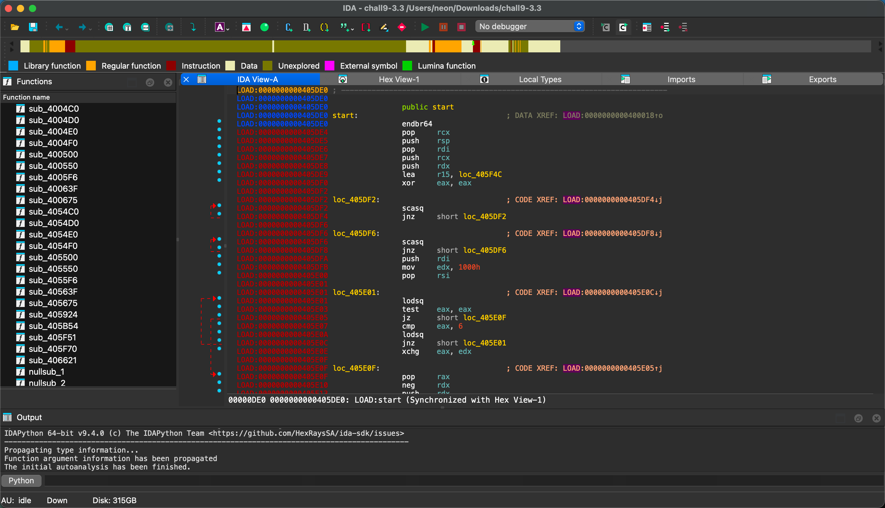
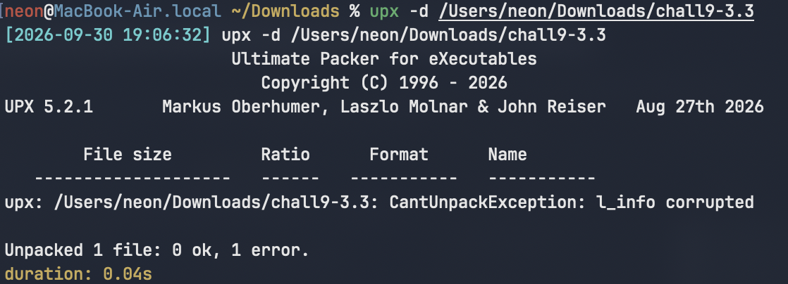
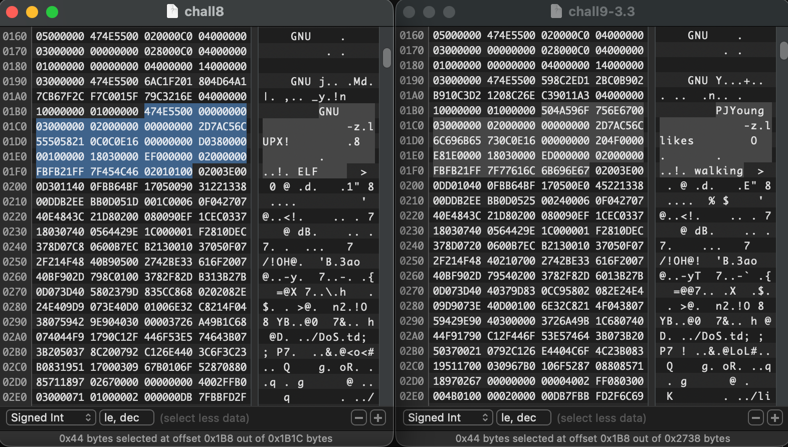
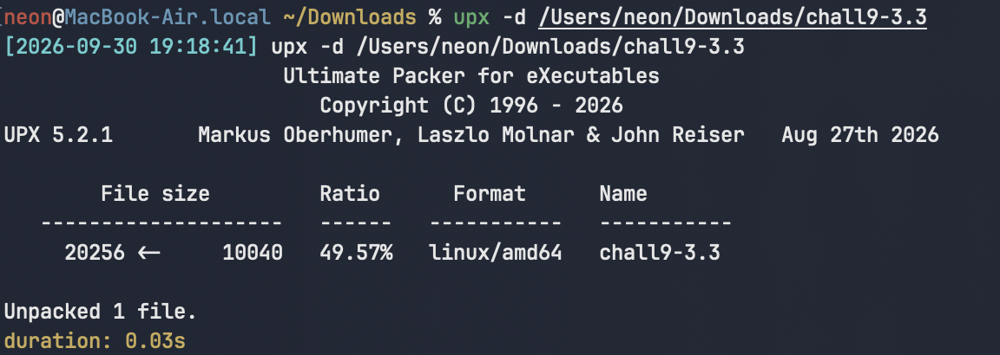
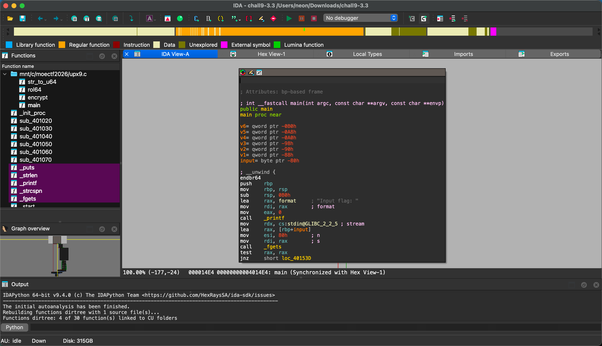
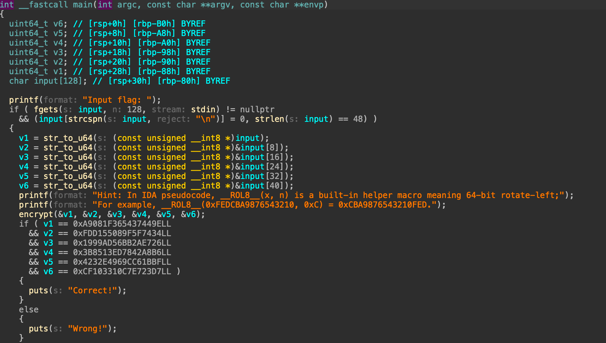
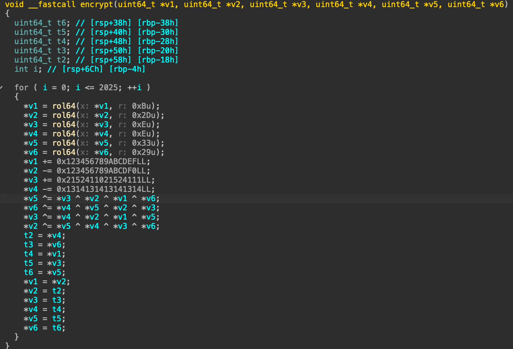
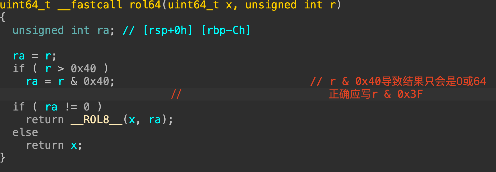

# [Ultato Polosion Xptra](https://ctf.xidian.edu.cn/games/37/challenges?challenge=1320)
##### 分值：200pts

## 题目描述：
### 原文：超爆炸土级大豆

## 分析：
### UPX 加密逆向

## 解题步骤：
IDA:
可以看到，我们什么都看不到...

Shift+F12，查看字符串，发现：
得出此题使用了UPX壳。
尝试脱壳：`upx -d chall9.3`

脱壳失败，怀疑壳被篡改。用二进制查看：（左侧为[Ultra Potato Xplosion](https://ctf.xidian.edu.cn/games/37/challenges?challenge=1318) UPX壳程序样本）
对比选中部分发现异常内容：PJYoung likes walking

从正常样本中复制过来替换掉chall9.3的异常部分，保存，再次执行`upx -d chall9.3`，成功脱壳：

再次IDA：符号出现了！
反编译main，看到密文和校验逻辑：
反编译encrypt，看到其简单的加密逻辑
其中rol64为循环左移。根据算法的对称性，即可写出decrypt函数。
```c
// chall9.3-solve.c: Ultato Polosion Xptra
#include <stdio.h>
#include <stdint.h>
#include <string.h>

uint64_t cipher[6] =
{
    0xA9081F365437449ELL,
    0xFDD155089F5F7434LL,
    0x1999AD56BB2AE726LL,
    0x3B8513ED7842A8B6LL,
    0x4232E4969CC61BBFLL,
    0xCF103310C7E723D7LL,
};

#define rol64(x, r) __builtin_rotateleft64((x), (r)) // 此为gcc/clang 循环左移builtin（未使用，仅为声明（就是IDA中的__ROL8__））
#define ror64(x, r) __builtin_rotateright64((x), (r)) // 此为gcc/clang 循环右移builtin

void decrypt(uint64_t *v1, uint64_t *v2, uint64_t *v3, uint64_t *v4, uint64_t *v5, uint64_t *v6)
{

    for (int i = 0; i < 2026; ++i) {
        uint64_t a=*v1, b=*v2, c=*v3, d=*v4, e=*v5, f=*v6;
        *v1=d; *v2=a; *v3=e; *v4=b; *v5=f; *v6=c;
        *v2 ^= *v5 ^ *v4 ^ *v3 ^ *v6;
        *v3 ^= *v4 ^ *v2 ^ *v1 ^ *v5;
        *v6 ^= *v4 ^ *v5 ^ *v2 ^ *v3;
        *v5 ^= *v3 ^ *v2 ^ *v1 ^ *v6;
        *v4 += 0x1314131413141314LL;
        *v3 -= 0x2152411021524111LL;
        *v2 += 0x123456789ABCDF0LL;
        *v1 -= 0x123456789ABCDEFLL;
        *v6 = ror64(*v6, 41);
        *v5 = ror64(*v5, 51);
        *v4 = ror64(*v4, 14);
        *v3 = ror64(*v3, 14);
        *v2 = ror64(*v2, 45);
        *v1 = ror64(*v1, 11);
    }
}
int main()
{
    decrypt(cipher, cipher+1, cipher+2, cipher+3, cipher+4, cipher+5);
    for (int i = 0; i < 6; ++i)
        cipher[i] = __builtin_bswap64(cipher[i]); 
        // 此为gcc/clang 64字节序翻转builtin
        // 作用：把 64 位整数的 8 个字节顺序完全反转
        // 即对应样本main的str_to_u64
        // 由于此操作自逆，故还原时相同

    puts((char*)cipher);
}
```
## Flag
moectf{M0d1fi3d_UPX_Comb1ned_w1Th_Littl3_Crypt0}

## 补充：样本 rol64 实现中的隐藏问题
此题目中的rol64实现中存在语义错误，（好在使用时未触发错误路径）：
函数原想在r超过64后截断r，但是截断写法出错...
正确写法：
```c
uint64_t rol64(uint64_t x, unsigned int r)
{
    if ( r > 0x40 )
        r &= 0x3F;
    if ( r != 0 )
        return __ROL8__(x, ra);
    else
        return x;
}
```
或者直接
`#define rol64(x, r) __builtin_rotateleft64((x), (r))`，
因为在x64下，循环位移的指令在执行时会自动截断r，并且 r = 0 时也不会出错。
