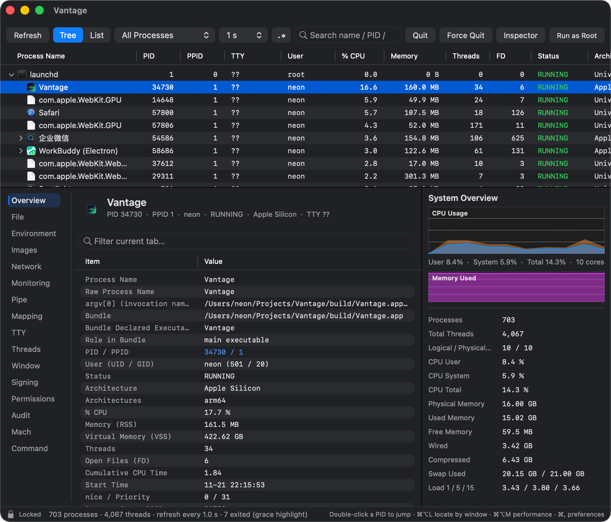
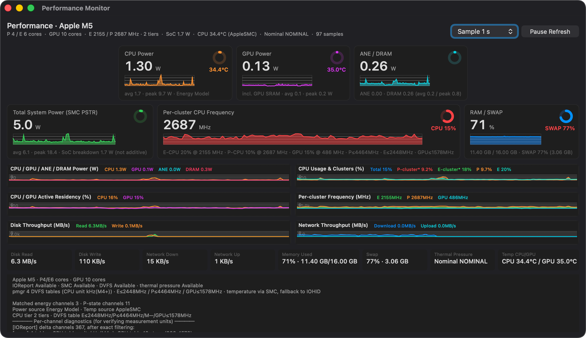
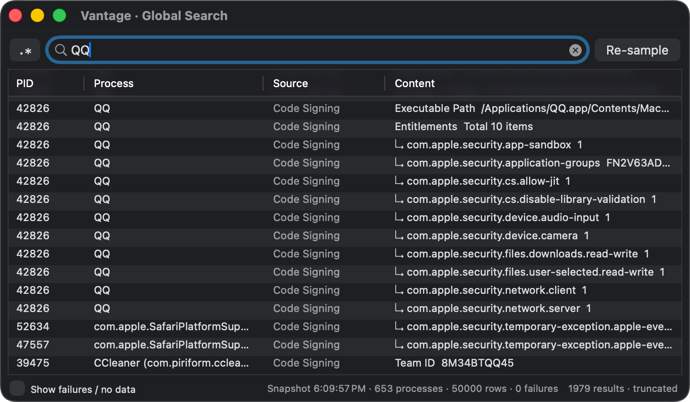
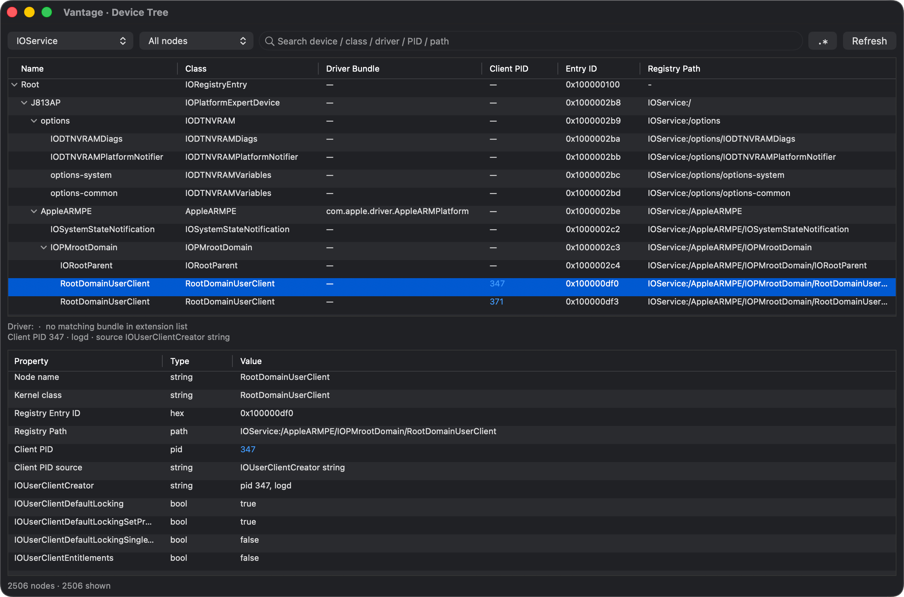
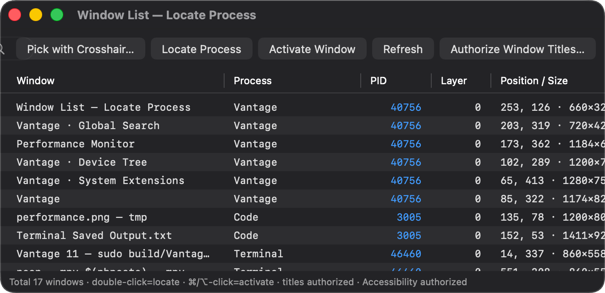

---

title: Vantage：一个 macOS 原生 GUI 进程管理器
published: 2026-11-24
description: '用 C 采集、Swift/AppKit 做界面，不弹 sudo、不依赖 powermetrics、不是 Electron——一个能离线构建的 macOS 进程管理器。'
image: ''
tags: [macOS, Swift, AppKit, C]
category: 'Dev'
draft: false
lang: 'zh_CN'
---

# 前言

~~neon最近迷上了vibe coding...~~

众所皆知，macOS有自带的进程管理器，Activity Monitor，然而...这个App自身启动就需要占用大量的性能。

所以 neon 用AI写了一个替代品：**Vantage** ~~（虽然似乎性能开销还是挺大的，但至少比AM快...）~~。

::github{repo="nanacaret"}

# Vantage的构造

语言： **C（Data）+ Swift / AppKit（GUI）** （因为neon在一开始给AI投喂的数据收集代码是C写的，所以AI就沿用了...）

主程序：
- Vantage：GUI程序
- vantage：CUI程序 ~~（功能有限，基本只能读取信息）~~
- vantage-mcp：MCP接口 ~~（neon让AI随手写的，功能有限...）~~

# Vantage能做什么

主窗口是一棵进程树（默认全部折叠，而且没有持久化... ~~（主要是这不重要，所以neon没有让AI改...）~~），按 PPID 还原父子关系（launchd 为根），也可以一键切成扁平列表。每列均可排序，同一表头三态循环：正序 → 反序 → 回到树形。刷新间隔 0.5 / 1 / 2 / 5 秒可调，采集在后台队列，刷新时保留选中项和展开状态。

双击任意进程打开检查器，当前共 16 个页签 ~~（v3是这样的，不然就是又更新了）~~：概览、文件、环境、镜像、网络、监控、Pipe、映射、TTY、线程、窗口、签名、权限、审计、Mach、命令。这些页签不是一次性全采——选中进程时只更新「概览」和「命令」（纯快照，零系统调用），其余页在第一次切过去时才采集，结果按 `(pid, 页)` 缓存。

*主窗口：进程树、14 个可排序列，右侧是检查器的「概览」页。*

性能面板（⌘⌥M）给的是 CPU / GPU / ANE / DRAM 分项功耗、SMC 的整机功率、CPU 与 GPU 温度、按 P-state residency 加权的分簇频率，以及磁盘、网络吞吐和热压等级。每个通道都有诊断读数，可以拿去和 macmon 对数。

~~（AI照着macmon写的，似乎数据还是不准，凑合看吧...）~~

*性能面板：分项功耗、整机功率、温度、分簇频率，以及用来核对单位的逐通道诊断。*

另外还有几个不那么常见的窗口：~~（不管有没有用，neon想到什么就加什么...后面也懒得截图了...）~~

- **全局搜索（⌘⇧F）**：先冻结一份进程快照，再对所有进程的所有页签采样；快照可以导出成 gzip JSON，也能导入回来离线搜索或做逐行对比。
- **设备树（⌘⌥B）**：按 7 个 plane 浏览 IORegistry，能看到驱动 bundle、`IOUserClientCreator` 对应的 PID 和完整属性表。
- **窗口定位（⌘⌥L）**：拖一个准星到任意窗口上，直接跳到拥有它的进程；反过来的「窗口列表」可以按 owner PID 找窗口，双击把那个窗口前置。
- **启动项（⌘⌥J）**：把 launchd 落盘的 job 全列出来（系统 / 全局 / 各用户），显示运行状态和 plist 展开结果，第三方条目可以 load / unload / enable / disable。
- **网络（⌘⌥N）**：接口、地址表、路由表，能直接起停链路、改 MTU、增删地址和路由。

*全局搜索先冻结快照，再对所有进程取样，结果能直接跳回对应页签和行。*

*设备树：节点、驱动 bundle、客户端 PID 与完整属性表。*

*窗口列表：双击定位进程，⌘ / ⌥ + 单击把那个窗口前置。*

# Vantage的设计

- 提权走 Authorization Services 的系统密码框，不是 `sudo`。可选的 Touch ID 模式会装一个 root LaunchDaemon helper，之后提权改弹指纹 ~~（其实之前neon写过一个指纹版的sudo的，但为了不通用，neon让AI又写了一个Vantage专用版）~~；helper 只接受「控制台用户 + 管理员 + 代码签名 CDHash 与自己一致 ~~（其实helper就是Vantage主程序的binary本身，所以AI就大胆的设置了很严格的验证...但是neon还是又审过一遍了，把TOCTOU给修了...）~~」的客户端，并且只放行 `ifconfig`、`route`、`launchctl` 和 App 自己的隐藏写入模式。 ~~（本来AI写的还有的，但是neon把实际上没有用到的删了）~~ 

采集层是独立的：`vantage` 命令行和 `vantage-mcp`（stdio JSON-RPC，给 Claude Desktop / Cursor 这类客户端用）复用的是同一套 C 采集，不需要 GUI 在跑。另外还有一份 AppleScript 字典。

**task port降级** Vantage大部分数据均不需要task port，所以在SIP完全开启的状态下也能获取很多信息。（其实是neon给AI太强调不使用Task Port了，导致AI非常保守，使用Task Port作增强的代码都不好好写了...）~~（所以不是降级，是基本没有更高级的...）~~

**私有接口只做可选增强。** IOReport、AppleSMC、IOHIDEventSystem 都是 `dlopen` / `dlsym` 运行时解析的，任何一个符号缺失就整条链路降级，不会导致 App 启动失败。（AI代码的典型特征，基本都用dlopen，并实现降级~~（如果neon自己写的话，肯定直接不管直接手动声明导入了...）~~）

**慢的东西不放在刷新路径上。** 详情页采集本来就慢（一个进程几十个 FD、上千个 VM region），所以做了惰性加载和分级缓存：FD / socket / pipe 缓存 2 秒，环境 / 镜像 / 映射 / 签名缓存 60 秒，⌘R 强制重采。~~（初始版本的Vantage CPU利用率比AM还恐怖...）~~

**采集和界面彻底分开。** C 层（`CProc`）只负责把数据填进结构体，`VantageKit` 做共享封装，AppKit 只负责显示。这样 CLI 和 MCP 服务不需要链接 AppKit，也能拿到和检查器完全一样的数据。~~（AI好像把结构重写了好多次...）~~

# 结语

Vantage 就是neon想用来替代 Activity Monitor的程序，不过还远远没有完成... ~~（特别是有些UI还是很丑...）~~
